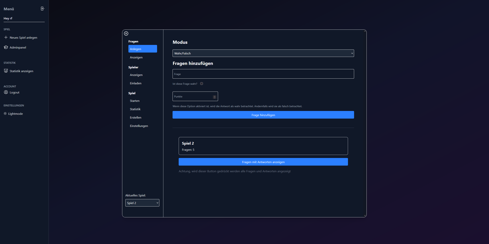

# TheBuzz

Welcome to TheBuzz, a real-time multiplayer quiz web application built for hosting interactive quiz nights with friends, family, or live stream audiences. A host creates and moderates the quiz from the admin panel, while players join instantly via an invite link in their browser without needing an account.

## Table of Contents
- [Features](#features)
- [Highlights](#highlights)
  - [Creating a Game and Adding Questions](#creating-a-game-and-adding-questions)
  - [Inviting Players and Starting a Round](#inviting-players-and-starting-a-round)
  - [Live Gameplay and Buzzer](#live-gameplay-and-buzzer)
- [Deployment](#deployment)
- [Tech Stack](#tech-stack)

## Features

You can use TheBuzz to:

- Create and manage multiple quiz games from a dedicated admin panel
- Add different question types: Buzzer, Multiple Choice, True/False, Open Estimation, and Picture Questions
- Sort questions manually via Drag & Drop or shuffle them randomly
- Invite players via a generated link or email (players join with just a username, no registration required)
- Moderate live rounds in real time: unlock questions, reset buzzers, reveal answers, and award or deduct points
- Freely position and lock player scorecards on the host screen for screen sharing or streaming
- View automatic end-of-game leaderboards and game statistics

Thank you for taking the time to explore TheBuzz!

## Highlights

### Creating a Game and Adding Questions
<video controls src="2026-10-29 16-34-01.mp4" title="Title"></video>

### Inviting Players and Starting a Round
<video controls src="Einladen und Spiel starten.mp4" title="Title"></video>

### Live Gameplay
<video controls src="Spielablauf.mp4" title="Title"></video>

## Deployment

Check out the live version of TheBuzz here: [TheBuzz](https://www.thebuzz-quiz.de)

## Tech Stack

- React
- Next.js
- Node.js
- Express
- Socket.IO
- Tailwind CSS
- Framer Motion
- JavaScript
- MongoDB
- Mongoose
- NextAuth
- AWS S3
- Nodemailer
- Git
